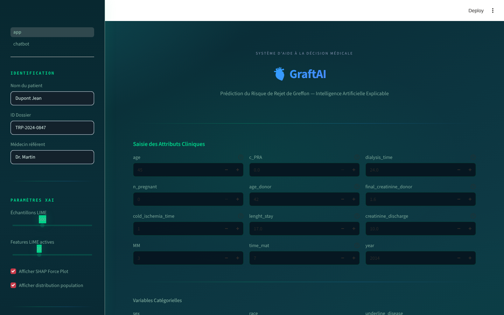
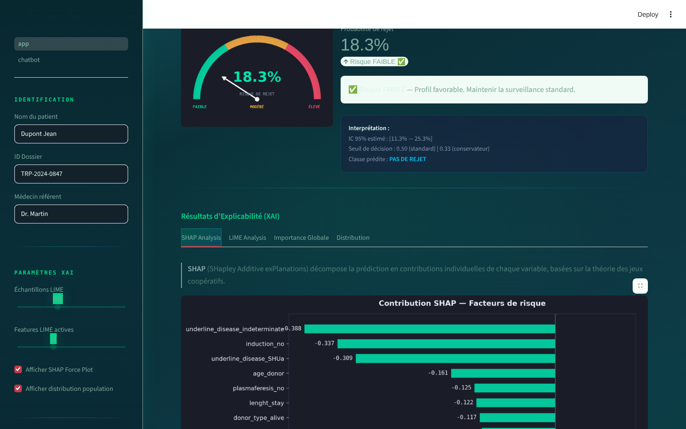
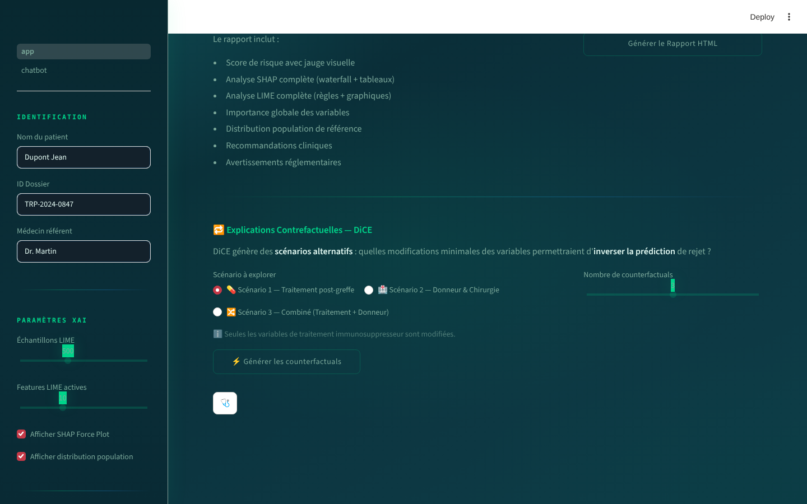
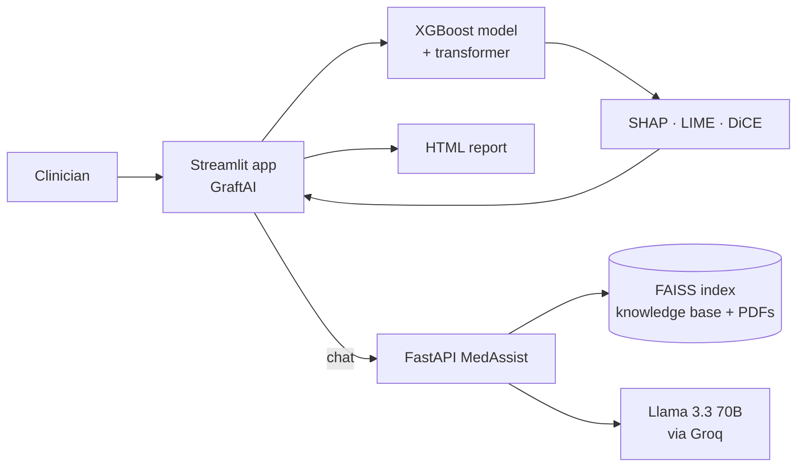

# NephroTech · GraftAI — Explainable Prediction of Kidney Graft Rejection

> A clinical decision-support app that estimates the risk of **kidney-transplant rejection** for a patient and shows **why**: SHAP and LIME explanations, counterfactual "what-if" scenarios with DiCE, an exportable HTML report, and **MedAssist**, a RAG chatbot that answers medical questions.




## Why

A risk score alone does not help a nephrologist decide. GraftAI pairs every prediction with the factors that drive it and with the smallest changes (treatment, donor, surgery) that would lower the risk.

## Features

- **Risk prediction** — XGBoost classifier on ~50 recipient, donor and treatment variables (age, cPRA, dialysis time, donor type and age, cold ischemia time, HLA mismatches, induction and immunosuppression…), shown as a risk gauge with an interpretation.
- **SHAP** — per-patient waterfall and force plots plus global importance.
- **LIME** — local rule-based explanation, with configurable number of samples and features.
- **DiCE counterfactuals** — three scenarios: post-transplant treatment, donor & surgery, or both combined.
- **Population view** — where the patient stands in the training distribution.
- **HTML report** — gauge, SHAP, LIME, global importance and recommendations in one exportable file.
- **MedAssist chatbot** — FastAPI service doing retrieval-augmented generation over an internal knowledge base and medical PDFs (LangChain, FAISS, `all-MiniLM-L6-v2` embeddings, Llama 3.3 70B via Groq).

| Prediction & SHAP | Counterfactual scenarios (DiCE) |
|---|---|
|  |  |

## Data & modelling

- Cohort of **38 kidney-transplant recipients** (Brazil), 54 clinical variables; target = rejection (yes/no).
- Notebooks in `travail_ML/`: exploratory analysis, preprocessing (encoding, scaling), Random Forest and XGBoost with grid search and class-imbalance weighting.
- With so few patients the test set holds only 8 cases (75 % accuracy for both models), so the project focuses on **explainability and decision support** rather than on headline metrics; a larger cohort would be needed for clinical validation.

## Architecture



## Getting started

```bash
git clone https://github.com/eya-dl/NephroTech-GraftAI.git
cd NephroTech-GraftAI

# Explainable prediction app
cd graftai_app
pip install -r requirement.txt xgboost dice-ml openpyxl
streamlit run app.py

# MedAssist chatbot API (optional, in another terminal)
cd ../fastapi_app
pip install -r requirement.txt
export GROQ_API_KEY=your_key        # Windows: set GROQ_API_KEY=your_key
uvicorn api:app --port 8000
```

## Project structure

```
graftai_app/
  app.py            Streamlit entry point
  config.py         feature definitions (ranges, defaults, labels)
  model.py          model loading and prediction
  xai/              SHAP and LIME utilities
  dice_runner.py    counterfactual generation
  ui/               inputs, sidebar, result display, DiCE view, chat widget
  utils/report.py   HTML report
  pages/chatbot.py  full-page chatbot
fastapi_app/api.py  MedAssist RAG API
travail_ML/         EDA and modelling notebooks, dataset
```

## Disclaimer

Research and educational project — not a certified medical device; predictions must not replace clinical judgement.

## Author

**Eya Dhambri** — AI engineering student at ENSI (Tunisia) · [LinkedIn](https://www.linkedin.com/in/eya-dhambri) · eya.dhambri@ensi-uma.tn
